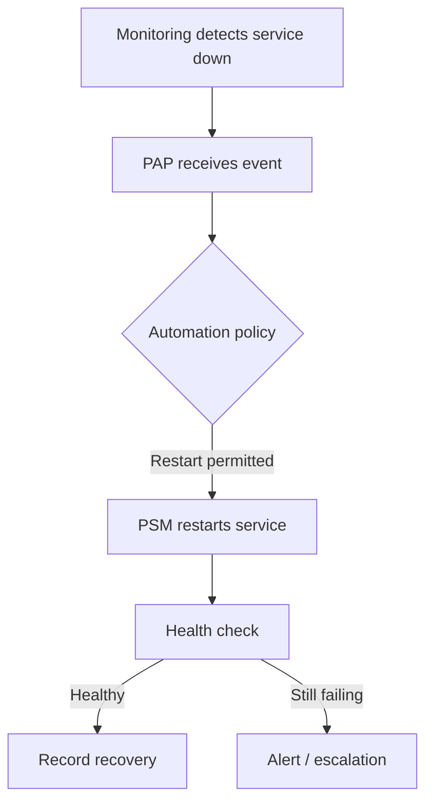

# Personal Cloud Management Platform — Architecture & Roadmap

## 1. Tujuan

Membangun homelab menjadi **Personal Cloud Management Platform**: satu platform terstruktur untuk mengelola server, project, deployment, database, monitoring, IoT, otomasi, dan akses.

Komponen yang dimiliki:

- **Personal API Platform (PAP):** pusat integrasi, koordinasi, API, autentikasi, konfigurasi, event, dan otomasi.
- **Personal Server Manager (PSM):** operasi server, monitoring, Docker, deployment execution, logs, health checks, dan backup execution.
- **PostgreSQL:** core data platform, metadata, konfigurasi, user, audit, dan data sistem.
- **MySQL:** database aplikasi yang memerlukan MySQL.
- **Docker:** runtime untuk service dan project.
- **Prometheus / Grafana / Uptime Kuma / Telegraf:** monitoring dan observability.
- **Mosquitto MQTT:** transport data IoT.

## 2. Arsitektur yang disarankan

PAP sebaiknya berperan sebagai **Control Plane / Core Platform**, bukan hanya CRUD API.

```text
User / Client
├── Web Dashboard
├── Mobile
├── CLI
├── IoT Dashboard
└── Applications
        |
        v
Personal API Platform (PAP)
├── API Gateway
├── Authentication & Authorization
├── Project Registry
├── Server / Service Registry
├── Database Registry
├── Automation & Event Management
├── Central Configuration
├── Integrations
└── Audit & API Documentation
        |
        +------------------------+
        |                        |
        v                        v
Personal Server Manager      Infrastructure
(PSM)                        Services
├── Server Monitoring         ├── Docker
├── Docker Management        ├── MQTT
├── Deployment Execution     ├── Storage
├── Container Lifecycle      └── Network
├── Logs
├── Health Checks
└── Backup Execution
        |
        +------------------------+
        |                        |
        v                        v
PostgreSQL                 MySQL
Core platform data         Application databases

Observability:
Prometheus · Grafana · Telegraf · Uptime Kuma · (Loki optional)
```

> Ini logical architecture. Tidak semua komponen perlu menjadi container atau proses terpisah.

## 3. Pembagian tanggung jawab PAP dan PSM

### PAP — Platform & Intelligence Layer

- API Gateway / unified API
- Identity & Access Management (users, roles, permissions, API keys)
- Project Registry
- Server Registry
- Service Registry
- Database Registry
- Automation Rules
- Event Management
- Central Configuration
- Integrations
- Audit Trail
- API Documentation
- Mengkoordinasikan proses dan memanggil PSM

### PSM — Server Operations Layer

- Server monitoring
- Docker management
- Deployment execution
- Container lifecycle (start, stop, restart)
- Server commands
- Logs
- Resource monitoring
- Backup execution
- Health checks

**Prinsip:** PAP mengatur dan mengoordinasikan; PSM mengeksekusi dan memonitor operasi server. Hindari duplikasi fitur.

## 4. Kapabilitas API yang berguna

### 4.1 Unified Server Management API

Dashboard tidak perlu mengakses banyak service langsung atau menggabungkan data sendiri. PAP dapat menggabungkan data dari PSM, Prometheus, dan service registry.

Contoh endpoint:

```http
GET /api/v1/infra/overview
```

Contoh response:

```json
{
  "server": {
    "hostname": "homelab",
    "status": "online",
    "cpu_usage": 23.4,
    "ram_usage": 67.2,
    "disk_usage": 42.8
  },
  "docker": {
    "running": 14,
    "stopped": 2,
    "unhealthy": 1
  },
  "databases": {
    "postgresql": "healthy",
    "mysql": "healthy"
  },
  "services": {
    "grafana": "healthy",
    "mqtt": "healthy",
    "uptime_kuma": "healthy"
  }
}
```

Manfaat:
- Satu endpoint untuk overview.
- Format response konsisten.
- Frontend lebih sederhana.
- Mudah dipakai oleh dashboard, mobile, dan CLI.

### 4.2 Deployment API

PAP menjadi orchestration layer untuk deployment. PSM melakukan operasi aktual di server.

Endpoint yang mungkin:

```http
GET    /api/v1/projects
POST   /api/v1/projects
GET    /api/v1/projects/{id}
POST   /api/v1/projects/{id}/deploy
POST   /api/v1/projects/{id}/restart
POST   /api/v1/projects/{id}/stop
POST   /api/v1/projects/{id}/rollback
GET    /api/v1/projects/{id}/logs
GET    /api/v1/deployments/{deployment_id}
```

Deployment flow:

```text
Dashboard
   |
   v
PAP API
   |
   ├── Verify user & permission
   ├── Validate project configuration
   ├── Create deployment record
   └── Send job to worker / PSM
             |
             v
         PSM / Worker
         ├── Clone or pull repository
         ├── Build image
         ├── Deploy container
         ├── Health check
         └── Report status
             |
             v
         PAP records result
```

Contoh hasil:

```json
{
  "deployment_id": "dep-20261119-001",
  "project": "stock_umkm",
  "status": "success",
  "version": "v1.8.2",
  "duration_seconds": 43,
  "health_check": "passed"
}
```

Untuk proses yang lama, API sebaiknya segera mengembalikan `deployment_id`; frontend kemudian polling atau menerima event/WebSocket untuk progres. Jangan menahan HTTP request sampai build/deploy selesai.

### 4.3 Database Management API

PAP mengelola metadata dan lifecycle database, bukan menjadi proxy untuk setiap query aplikasi.

Endpoint:

```http
GET    /api/v1/databases
GET    /api/v1/databases/{id}/health
GET    /api/v1/databases/{id}/metrics
POST   /api/v1/databases/{id}/backup
GET    /api/v1/databases/{id}/backups
POST   /api/v1/databases/{id}/restore
```

Contoh registry:

| Database | Engine | Project | Status |
|---|---|---|---|
| pap_core | PostgreSQL | PAP | Healthy |
| psm | PostgreSQL | PSM | Healthy |
| stock_umkm | MySQL | Stock UMKM | Healthy |
| bropos | MySQL | POS | Healthy |

Aplikasi tetap dapat menggunakan koneksi database internal secara langsung:

```text
Stock UMKM ──> MySQL
Bropos POS ──> MySQL
PAP ─────────> PostgreSQL
PSM ─────────> PostgreSQL
```

PAP mengelola:
- Database registry
- Provisioning
- Credentials / secret reference
- Monitoring
- Backup & restore
- Access policy
- Audit

Jangan memaksa seluruh transaksi database aplikasi melewati PAP karena bisa menjadi bottleneck dan menambah kompleksitas.

### 4.4 Automation Engine

PAP dapat mengatur otomasi berdasarkan event, jadwal, atau kondisi.

| Trigger / kondisi | Action |
|---|---|
| Container crash | Restart jika policy mengizinkan |
| Disk usage > 85% | Alert |
| Backup gagal | Retry dan notifikasi |
| Project baru dibuat | Generate deployment config |
| Database dibuat | Generate credentials dan backup policy |
| Server reboot | Verifikasi service |
| Health check gagal | Mark unhealthy dan alert |
| Git push ke branch production | Trigger deployment jika diaktifkan |

Contoh:



### 4.5 IoT Integration API

Arsitektur yang disarankan:

```text
ESP32 / Devices
      |
      v
Mosquitto MQTT
      |
      +----> Telegraf ----> Prometheus ----> Grafana
      |
      +----> PAP MQTT Consumer
                    |
                    v
               PAP API
                    |
             +------+------+
             |             |
             v             v
        PostgreSQL    IoT Dashboard
```

MQTT tetap menjadi transport telemetry realtime; Prometheus untuk metrics; Grafana untuk visualisasi. PAP menyediakan registrasi, kontrol, data bisnis, integrasi, dan API.

Endpoint contoh:

```http
GET  /api/v1/iot/devices
GET  /api/v1/iot/devices/{device_id}
GET  /api/v1/iot/machines
GET  /api/v1/iot/machines/{machine_id}/production
GET  /api/v1/iot/production/summary
POST /api/v1/iot/devices/register
```

PAP dapat menangani:
- Device registry dan identity
- Device authentication
- Machine configuration
- Status device
- Riwayat produksi
- Output counter
- Alarm suhu
- Device provisioning
- Konfigurasi pengiriman data
- API untuk dashboard dan aplikasi

Dashboard tidak harus memahami MQTT. Dashboard cukup mengambil data melalui PAP sesuai kebutuhan.

### 4.6 Central Authentication

PAP dapat menjadi identity provider / auth service untuk berbagai aplikasi:

```text
PAP Identity
├── Users
├── Roles
├── Permissions
├── API Keys
└── Access Tokens
       ├── PSM
       ├── IoT Dashboard
       ├── Stock UMKM
       ├── POS
       └── Internal Services
```

Role contoh:

| Role | Hak akses |
|---|---|
| Super Admin | Semua sistem |
| Server Admin | Server, Docker, deployment |
| Developer | Deploy project yang diizinkan |
| IoT Operator | Monitoring dan data mesin |
| Viewer | Read-only |

Gunakan permission granular, bukan hanya role tunggal. Misalnya developer dapat restart project miliknya tetapi tidak dapat menghapus container lain atau mengakses host database.

## 5. Modul / dashboard yang dapat dikembangkan

1. **Infrastructure Hub** — server, CPU, RAM, disk, network, uptime, Docker, service health.
2. **Project Center** — repository, environment, deployment, logs, version, restart, rollback.
3. **Database Center** — PostgreSQL/MySQL registry, health, backup, restore, kapasitas.
4. **IoT Center** — device registry, MQTT status, telemetry, machine output, suhu, konfigurasi, alarm.
5. **Security Center** — user, role, API keys, credentials/secret references, login history, audit trail.
6. **Automation Center** — rules, triggers, actions, scheduler, notifications, recovery policy, history.

## 6. Struktur code PAP (FastAPI)

Rekomendasi: **modular monolith terlebih dahulu**, bukan microservices. Satu API/deployment utama, modul terpisah, batas domain jelas.

```text
personal-api-platform/
├── app/
│   ├── main.py
│   ├── core/
│   │   ├── config.py
│   │   ├── security.py
│   │   ├── permissions.py
│   │   ├── events.py
│   │   └── exceptions.py
│   ├── modules/
│   │   ├── auth/
│   │   ├── users/
│   │   ├── servers/
│   │   ├── projects/
│   │   ├── deployments/
│   │   ├── databases/
│   │   ├── services/
│   │   ├── monitoring/
│   │   ├── iot/
│   │   ├── automation/
│   │   ├── backup/
│   │   ├── notifications/
│   │   └── audit/
│   ├── integrations/
│   │   ├── psm/
│   │   ├── docker/
│   │   ├── prometheus/
│   │   ├── grafana/
│   │   ├── mqtt/
│   │   └── databases/
│   └── workers/
│       ├── deployment_worker.py
│       ├── backup_worker.py
│       └── automation_worker.py
├── migrations/
├── tests/
├── Dockerfile
├── docker-compose.yml
└── README.md
```

## 7. Teknologi yang disarankan

| Komponen | Pilihan | Fungsi |
|---|---|---|
| API | FastAPI | REST API |
| Core database | PostgreSQL | Data core PAP |
| Cache / queue broker | Redis (opsional) | Cache / queue |
| Task worker | Celery / Dramatiq | Background tasks |
| Runtime | Docker Compose | Menjalankan services |
| Metrics | Prometheus | Metrics |
| Dashboard | Grafana | Visualisasi |
| Logs | Loki (opsional) | Centralized logs |
| IoT transport | Mosquitto MQTT | Telemetry |
| Authentication | JWT + RBAC | Identity & access |
| Reverse proxy | Traefik / Nginx | Routing |
| Backup | Restic | Backup / recovery |
| Notifications | Telegram integration | Alert |

Jangan install semua sekaligus. Untuk server dengan resource terbatas, tambahkan Redis, Loki, dan worker terpisah saat ada kebutuhan nyata.

## 8. Roadmap implementasi

### Phase 1 — Core Foundation
- [ ] Authentication
- [ ] User dan role
- [ ] API keys
- [ ] Project registry
- [ ] Server registry
- [ ] Service registry
- [ ] Audit log
- [ ] API documentation

### Phase 2 — Server Integration
- [ ] Integrasi PAP ↔ PSM
- [ ] Unified server overview
- [ ] Docker status
- [ ] Service health
- [ ] Logs
- [ ] Start / stop / restart

### Phase 3 — Deployment Center
- [ ] Git repository management
- [ ] Environment configuration
- [ ] Deploy
- [ ] Deployment history
- [ ] Health check
- [ ] Rollback

### Phase 4 — Database Center
- [ ] PostgreSQL registry
- [ ] MySQL registry
- [ ] Provision database
- [ ] Backup
- [ ] Restore
- [ ] Backup monitoring

### Phase 5 — Automation
- [ ] Event system
- [ ] Scheduled tasks
- [ ] Recovery rules
- [ ] Notifications
- [ ] Workflow history

### Phase 6 — IoT Platform
- [ ] Device registry
- [ ] MQTT integration
- [ ] Machine registry
- [ ] Telemetry API
- [ ] Production analytics

## 9. Prinsip arsitektur

- PAP adalah pusat koordinasi, integrasi, policy, dan API.
- PSM adalah eksekutor operasi server.
- Jangan duplikasi fungsi PSM di PAP.
- Aplikasi boleh mengakses database internal secara langsung untuk transaksi normal.
- PAP mengelola database lifecycle, registry, monitoring, backup, dan access policy.
- Gunakan asynchronous worker untuk deployment, backup, restore, dan pekerjaan panjang.
- Semua operasi penting memiliki status, history, dan audit.
- Gunakan permission granular dan least privilege.
- Secrets jangan disimpan plaintext dalam response API, log, atau Git.
- Mulai dengan modular monolith; pecah menjadi services hanya jika kebutuhan dan skala membenarkan.

## 10. Kesimpulan

PAP paling bernilai jika menjadi **Personal Cloud Management Platform**:

- Dashboard satu pintu untuk homelab.
- API standar untuk seluruh project.
- Koordinasi deployment melalui PSM.
- Pengelolaan PostgreSQL dan MySQL.
- Integrasi monitoring dan IoT.
- Central authentication dan permission.
- Automation, event, backup, dan recovery.

### Langkah strategis berikutnya

Rancang **kontrak API PAP ↔ PSM** lebih dahulu: endpoint, internal authentication, request/response schema, deployment lifecycle, error format, dan event. Ini menjadi fondasi integrasi tanpa membuat PAP dan PSM saling menduplikasi fitur.
